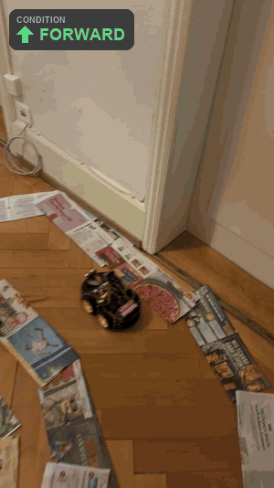
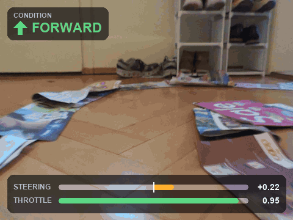
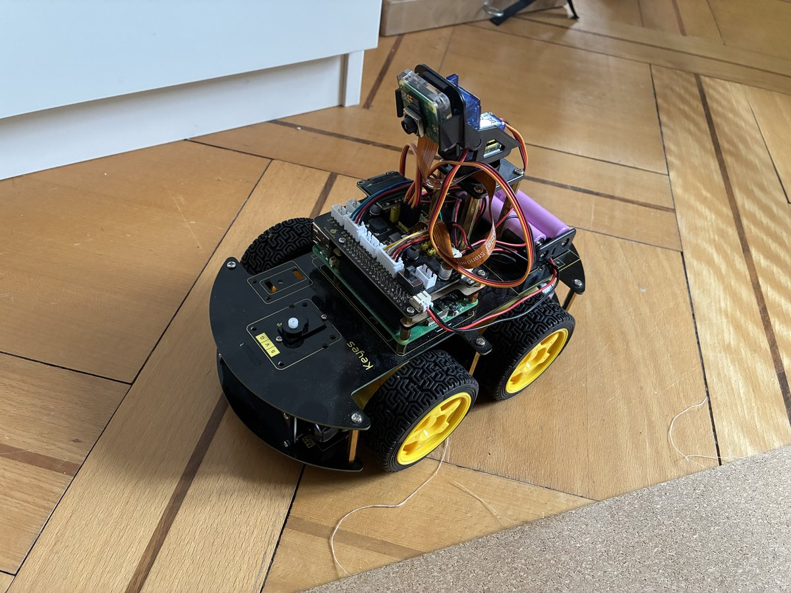

# keyecar-pi

[](https://github.com/YvesMG1/keyecar-pi/actions/workflows/ci.yml)


A Raspberry Pi 5 RC car that drives itself with a small neural network. It sees the road through a
single camera, gets a route command (forward, left, or right) from a game controller, and outputs
throttle and steering 20 times per second. Everything runs on the Pi.

I trained the network on my own driving and then improved it with DAgger. Whenever the car made a
mistake I took over, and those corrections became training data for the next round.

<p align="center">
  
  <br>
  <sub>Autonomous run on a newspaper track. The badge shows the route command I gave with the controller.</sub>
</p>

> **Video:** a full-length driving video will be added soon.

## How I built it

1. **Collect data.** I drive the car with a PlayStation controller. Every frame is saved together with
   the route command and the human, model, and executed commands.
2. **Train.** A MobileNetV3-Small network with about 1M parameters learns to map camera frames, the
   route command, and the previous command to throttle and steering.
3. **Drive and correct.** The car drives on its own while I hold the controller. Moving the stick takes
   over instantly. Each takeover becomes new training data. That covers the frames I drove and the
   moments just before and after, when the model was already drifting. I review every session as a
   video before it is used.
4. **Repeat.** Retrain on the original demonstrations plus the corrections, export to ONNX, and drive
   again.

More detail in [docs/approach.md](docs/approach.md).

## On the car

<p align="center">
  
  <br>
  <sub>What the car sees, with the route command and the executed steering and throttle.</sub>
</p>

Each camera frame goes through the network with ONNX Runtime on the Pi's CPU, in about 9 ms. Manual
input always overrides the network. The stop button and an optional ultrasonic sensor act as
emergency stops.

## Results

The repo includes two models: one sees only the current frame, the other the last three. The
single-frame model is slightly more accurate offline, but the three-frame model depends less on its
own previous output, which matters more when the car drives itself, so it is the default. See
[docs/results.md](docs/results.md) for the numbers.

## Limitations and future work

This is a first version. The main open points are on the learning side.

**Model**
- **Global pooling loses position.** The image features are averaged over the whole frame, so the
  network loses most information about *where* the track is. A coarse spatial grid or attention
  pooling would suit steering better.
- **Short memory.** The history model sees only 3 frames (0.1 s), merged at the input. Encoding each
  frame and combining them over time (e.g. a small GRU or transformer) could use more context.
- **Copying the previous command.** Feeding the last command back in invites the model to repeat it.
  This is known as causal confusion ([de Haan et al., 2019](https://arxiv.org/abs/1905.11979)) or the
  copycat problem ([Wen et al., 2020](https://arxiv.org/abs/2010.14876)).
  Measured speed and turn rate from sensors would be a better input.

**Outputs and loss**
- **One step ahead.** The model only predicts the command for the current frame. Predicting several
  future commands or a short path ahead (action chunking, waypoints) tends to give smoother, more
  consistent driving.
- **The loss averages.** For small errors, Smooth L1 behaves like squared error, so the model learns
  the average of what I would do. Where several actions are fine (turn now or slightly later), the
  average is a weak signal.

**Data**
- **Small and narrow.** One driver, one room, newspaper tracks: about 12k demonstration frames plus
  5k from corrections.
- **Possible background shortcuts.** The camera sees a lot of fixed furniture, and a quarter of the
  input is letterbox padding. Cropping to the floor, and recording in other places, would show
  whether the model really follows the track.


## Hardware



- Keyestudio KS0223 4WD chassis with motor driver board
- Raspberry Pi 5
- Raspberry Pi camera, facing forward
- PlayStation controller
- HC-SR04 ultrasonic sensor (optional; without it, pass `--no-ultrasonic`)

Pins and controller mapping are in [`config.py`](src/keyecar/car/config.py).
<br clear="right">

## Getting started

On the Pi:

```bash
sudo apt install -y python3-picamera2 python3-rpi.gpio
git clone https://github.com/YvesMG1/keyecar-pi.git && cd keyecar-pi
python3 -m venv --system-site-packages .venv && source .venv/bin/activate
pip install -e ".[pi]"

keyecar-teleop --track "track 1"                      # drive and record
keyecar-drive --model models/rgb_history_dagger_v4    # drive autonomously
```

Controller: the left stick drives or takes over. Triangle, Square, and Circle set the route command
to forward, left, and right. Cross stops, and Options quits.

Training runs on a separate machine (GPU recommended). The review videos also need `ffmpeg`.

```bash
pip install -e ".[train]"
python -m keyecar.training.tools.intervention_windows recordings/<autonomy sessions>   # build corrections
python -m keyecar.training.train --variant rgb_history --out-dir runs/my_policy
python -m keyecar.training.eval runs/my_policy/best.pt
python -m keyecar.training.export runs/my_policy/best.pt --out-dir models/my_policy
```

The recorded dataset (about 1.4 GB) will be published separately. The included models work without it.

## Repository layout

```
src/keyecar/car/        runs on the Pi: control loop, camera, motors, recording, inference
src/keyecar/training/   runs off the car: dataset, DAgger, model, training, evaluation, export
models/                 the two trained models (ONNX, FP32 and INT8)
docs/                   approach, results, media
```

## License

[MIT](LICENSE)
