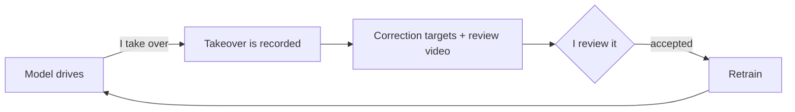

# Approach

How the car learns to drive. Results are in [results.md](results.md).

## The task

The car is a four-wheel skid-steer chassis with a Raspberry Pi 5 and a front camera. The tracks are
strips of newspaper on a wooden floor, rebuilt in several different layouts.

The network gets three inputs:

- **Camera frames:** either the current frame or the last three.
- **Route command:** forward, left, or right, from the controller. It only says which way to go at a
  junction. On a normal bend the command stays "forward" and the network has to steer by itself.
- **Previous command:** the throttle and steering that were executed one frame earlier.

It outputs throttle (0 to 1) and steering (-1 to 1), which are mixed into left and right wheel speeds.

## DAgger: learning from my corrections

A model trained only on my driving slowly drifts into situations it has never seen, and on the car
it tended to under-steer in bends. DAgger fixes this by collecting data in the situations the model
itself gets into.



While the car drives on its own, any stick movement hands control to me until I let go. The frames I
drive become training targets directly.

The frames right before a takeover matter too, since that is where the model started to go wrong.
Copying the model's own steering there would teach it the mistake again. Instead, the target steering
is shifted toward my correction:

```
target = model steering + alpha × (my steering − model steering at the takeover)
```

Over the 0.5 s before a takeover, `alpha` grows from 0.25 to 1. Over the 0.25 s after I let go, it
shrinks back to 0. These frames only teach steering, weighted by `alpha`. Very small corrections are
ignored.

The final models were trained on 11,816 frames of my own driving, 1,305 takeover frames, and 3,610
frames from around the takeovers. Corrections are rare compared with normal driving, so each
training batch has a fixed mix: 36 normal frames, 20 takeover frames, and 8 frames from around
takeovers.

## The model

A MobileNetV3-Small backbone (pretrained on ImageNet) processes the image, resized to 160×160 without
distorting it. The route command and the previous command are each encoded by a small layer, and a
small MLP combines everything to predict throttle and steering. The model has about 1M parameters.

The history model stacks the last three frames into 9 input channels. A 1×1 convolution reduces them
back to 3 channels. It starts out passing through only the newest frame, so the history model begins
exactly like the single-frame model and only learns to use older frames if they help.

## Training

| Setting | Value |
|---|---|
| Optimizer | AdamW, learning rate 1e-4, cosine schedule, 100 epochs |
| Loss | Smooth L1, with steering weighted 5× more than throttle |
| Previous-command dropout | the previous command is hidden for 25% of samples |
| Augmentation | brightness, contrast, color, shadows, blur, noise, JPEG artifacts, and horizontal flips |
| Model selection | lowest validation loss |

## The previous-command problem

Early models scored very well offline and still under-steered on the car. The reason is the
previous-command input. Offline, it comes from the recording, so it is always a good command. On the
car, it is the model's own last output. A model that relies too much on it ends up copying its last
command, which looks great offline and fails on the car.

So besides normal accuracy, every model is also tested with the previous command set to zero, and
with its own predictions fed back frame by frame. These tests don't measure accuracy, since there is
no correct answer for situations that never happened. They show how much the model's steering shifts
or collapses. Hiding the previous command during training (the dropout above) is the main way to
reduce this dependence.

## Things I tried and dropped

- **Floor masks as input:** SAM 3 labelled the drivable floor, and I trained a small segmentation
  network on those labels to feed floor masks to the policy. It was too slow on the Pi, so the final
  models use plain camera images.
- **No previous command at all,** as a comparison. The final models keep it and hide it 25% of the
  time instead.
- **An LLM driver,** an early experiment where a multimodal LLM steered the car through tool calls.
- **Stopping for obstacles:** learning to stop in front of blocked paths was too hard at the start,
  with little data and a small model. The ultrasonic sensor is now only an emergency stop.
