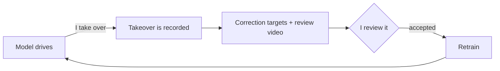

# Approach

How the car learns to drive. Results are in [results.md](results.md).

## The task

The car is a four-wheel skid-steer chassis with a Raspberry Pi 5 and a front camera. The tracks are
strips of newspaper on a wooden floor, rebuilt in several different layouts.

The network gets up to three inputs:

- **Camera frames:** the last three.
- **Route command:** forward, left, or right, from the controller. It only says which way to go at a
  junction. On a normal bend the command stays "forward" and the network has to steer by itself.
- **Previous command** (optional): the throttle and steering that were executed one frame earlier.

It outputs throttle (0 to 1) and steering (-1 to 1), which are mixed into left and right wheel speeds.

## DAgger: learning from my corrections

A model trained only on my driving slowly drifts into situations it has never seen, and on the car
it tends to under-steer in bends. DAgger fixes this by collecting data in the situations the model
itself gets into.



While the car drives on its own, any stick movement hands control to me until I let go. The frames I
drive become training targets directly.

The frames right before a takeover matter too, since that is where the model started to go wrong.
Copying the model's own steering there would teach it the mistake again. Instead, the target steering
is shifted toward my correction:

```
target = model steering + alpha × (my steering − model steering at the takeover)
```

Over the 0.5 s before a takeover, `alpha` grows from 0.25 to 1. Over the 0.25 s after I let go, it
shrinks back to 0. These frames only teach steering, weighted by `alpha`. Very small corrections are
ignored.

The models are trained on 11,816 frames of my own driving, 847 takeover frames, and 2,303 frames
from around the takeovers. Corrections are rare compared with normal driving, so each training batch
has a fixed mix: 36 normal frames, 20 takeover frames, and 8 frames from around takeovers.

One autonomy session with 133 takeovers is left out of training. It is only used to evaluate whether
the corrections carry over to takeovers the model has not seen.

## The model

A MobileNetV3-Small backbone (pretrained on ImageNet) processes the image, resized to 160×160 without
distorting it. The three frames are stacked into 9 input channels, and a 1×1 convolution reduces them
back to 3. It starts out passing through only the newest frame, so the model only learns to use older
frames if they help. The route command is encoded by a small layer, and a small MLP combines
everything to predict throttle and steering. The model has about 1M parameters.

Two parts of the head are options:

- **Previous command as input.** A model that gets it can lean on it. A model without it has to take
  every command from the image.
- **Steering output.** Either one regressed value, or a distribution over 25 bins from -1.2 to 1.2,
  trained with cross-entropy against a narrow bell around my steering. The car still gets one value:
  the mean of the bins around the most likely one. Bins can put all their weight on a hard turn, and
  they can keep two plausible answers apart where regression would average them.

## Training

| Setting | Value |
|---|---|
| Optimizer | AdamW, learning rate 1e-4, cosine schedule over 100 epochs, stopped after 61 |
| Loss | Smooth L1, with steering weighted 5× more than throttle |
| Backbone | the first 4 of 13 stages are frozen |
| Previous-command dropout | where the input is used, it is hidden for 25% of samples |
| Augmentation | brightness, contrast, color, shadows, blur, noise, JPEG artifacts, and horizontal flips |
| Model selection | lowest validation loss (`best.pt`) |

The repo includes four models. Each changes one thing:

| Model | Folder in `models/` | Flags added to the base command |
|---|---|---|
| Standard | `rgb_history_dagger_v5` | none |
| No previous command | `rgb_history_nomotor_v5` | `--no-motor-state` |
| Backbone fully trained | `rgb_history_nomotor_unfrozen_v5` | `--no-motor-state --freeze-stages 0` |
| Steering as bins | `rgb_history_nomotor_bins_v5` | `--no-motor-state --steering-bins 25 --throttle-loss-coef 5 --steering-loss-coef 1` |

```bash
python -m keyecar.training.train --variant rgb_history --epochs 61 --schedule-epochs 100 --out-dir runs/<name>
```

Cross-entropy is on a much larger scale than Smooth L1, so the bins model weights throttle 5× and
steering 1×.

## Evaluation

Offline, a model predicts on recorded frames and is scored against my command. Two things make the
plain error a poor measure, and the evaluation is built around them.

**Copying scores well.** At 20 Hz the stick barely moves between two frames. Repeating the previous
command, without looking at the image, has a steering error of only 0.026 on the validation sessions.
A model that gets the previous command as input can learn to do just that. This is known as causal
confusion ([de Haan et al., 2019](https://arxiv.org/abs/1905.11979)) or the copycat problem
([Wen et al., 2020](https://arxiv.org/abs/2010.14876)).
[ChauffeurNet](https://arxiv.org/abs/1812.03079) (Bansal et al., 2018) counters it with dropout on
the past-motion input, as the standard model does here.

**On the car, the previous command is the model's own.** So every model is evaluated with its own
last prediction fed back as the previous command, frame by frame. The image and my command stay the
same, so the score is still against my command.

The measures:

- **Steering error**, overall and on strong steering, next to the copy baseline.
- **Changed frames:** the error on the 3.6% of frames where my command moves away from the previous
  one. Only there does the image have to supply the answer.
- **Steering steps:** for each time I go from a steady command to one at least 0.4 away, how much
  later the model has followed half of the step, and how far it gets.
- **Whole turns:** for each of my turns, the model's summed steering as a share of mine. Summed
  steering is roughly the change of heading, so a model that turns a little later, or harder for a
  shorter time, still scores 100%. A turn counts as followed between 80% and 125%.
- **A held-out correction session:** on the first frame of each takeover, how much of the gap between
  the steering of the model that was driving and my correction the evaluated model closes.

All of this is open loop. The images come from my own drive, so a small error cannot grow into a
large one as it does on the car. These numbers can show that a model is bad, not that it drives well.

## Things I tried and dropped

- **Floor masks as input:** SAM 3 labelled the drivable floor, and I trained a small segmentation
  network on those labels to feed floor masks to the policy. It was too slow on the Pi, so the models
  use plain camera images.
- **A single-frame model:** three frames are slightly more accurate (steering error 0.112 against
  0.124).
- **An LLM driver,** an early experiment where a multimodal LLM steered the car through tool calls.
- **Stopping for obstacles:** learning to stop in front of blocked paths was too hard at the start,
  with little data and a small model. The ultrasonic sensor is now only an emergency stop.
